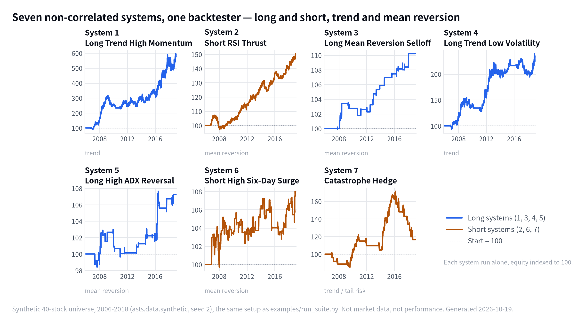
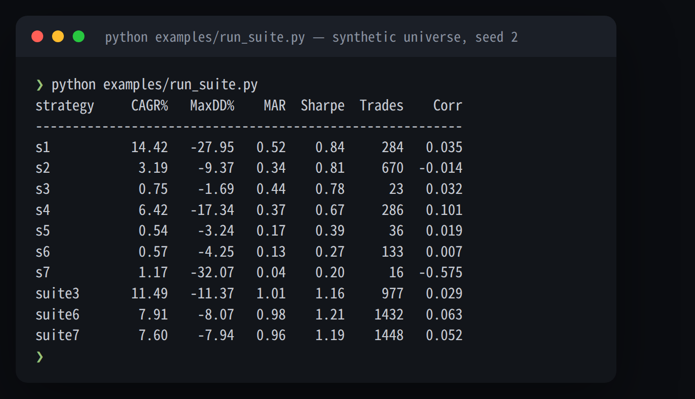
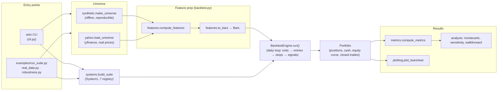

<picture>
  <source media="(prefers-color-scheme: dark)" srcset="docs/images/brand/wordmark-dark.svg">
  
</picture>

[English](README.md) | **한국어**

**Laurens Bensdorp의 7가지 비상관 트레이딩 시스템을 하나의 Python 백테스터로 재구현했습니다 — 데이터 벤더나 API 키 없이 1분 만에 실행할 수 있습니다.**
책에 공개된 규칙을 바탕으로 만든 교육용 재구현이며, 상용 트레이딩 제품이 아닙니다.

[](https://github.com/younghwan91/automated-stock-trading-systems/actions/workflows/ci.yml)
[](https://www.python.org/)
[](LICENSE)
[](https://www.linkedin.com/in/younghwan-chae/)

<picture>
  <source media="(prefers-color-scheme: dark)" srcset="docs/images/hero-dark.png">
  
</picture>

- **의도적으로 서로 다른 7개 시스템**: 롱 4개, 숏 3개; 추세 추종 3개, 평균 회귀 4개; 그중 하나는 SPY 숏을 이용한 폭락 헤지(crash hedge) 전략입니다.
- **오프라인 실행**: 기본 유니버스는 합성 데이터(`asts.data.synthetic`)입니다. 랜덤 워크 종목들과 상승/하락 국면이 스크립트로 설계된 지수를 포함하므로 추세 필터와 재해 헤지가 실제로 발동하며, 시드(seed)로 결과를 재현할 수 있습니다.
- **7개 모두를 구동하는 단일 엔진**: 일봉 이벤트 루프, 익일 시가(MOO)/종가(MOC)/지정가 체결, 보호 손절 및 트레일링 스톱, 2% 리스크 비율 사이징, 시스템당 최대 10개 포지션을 지원합니다. 새 시스템은 진입·청산 로직을 선언한 클래스 하나로 추가할 수 있습니다.

> ⚠️ **투자 조언이 아닙니다.** 연구 및 교육 목적으로만 제공됩니다. 자세한 내용은 [`DISCLAIMER.md`](DISCLAIMER.md)를 참고하세요.

## 빠른 시작

```bash
pip install -e .                     # core: pandas, numpy, pyyaml
python examples/run_suite.py         # each system alone vs. the suites; ~10 s offline
asts list                            # systems and suites
asts run --suite suite7 --synthetic  # all 7, offline
pip install -e ".[data]"             # + yfinance, for real prices
asts run --suite suite6 --symbols AAPL,MSFT,JPM --start 2010-01-01 --end 2019-12-31
```

## 7개 트레이딩 시스템

| 시스템 | 이름 | 스타일 | 방향 | 우위 및 진입 규칙 | 청산 / 보호 규칙 |
|---|---|---|---|---|---|
| **System 1** | Long Trend High Momentum | 추세 | 롱 | SPY > SMA100, 종목 SMA25 > SMA50; 200일 ROC 상위 종목 MOO 진입 | 25% 트레일링 스톱, 5×ATR 초기 손절 |
| **System 2** | Short RSI Thrust | 평균 회귀 | 숏 | 2일 연속 상승, RSI(3) > 90; 전일 종가 대비 +4% 지정가 숏 진입 | +4% 목표가(MOC) 또는 2일 시간 청산 |
| **System 3** | Long Mean Reversion Selloff | 평균 회귀 | 롱 | 종목 > SMA150, 3일 하락 ≥ 12.5%; 종가 대비 -7% 지정가 매수 | +4% 목표가(MOC) 또는 3일 시간 청산 |
| **System 4** | Long Trend Low Volatility | 추세 | 롱 | SPY > SMA200, HV(100) ∈ [10%, 40%], 가장 낮은 RSI(4) 순 랭킹 | 20% 트레일링 스톱, 1.5×ATR 손절 |
| **System 5** | Long High ADX Reversal | 평균 회귀 | 롱 | 종가 > SMA100+1×ATR, ADX(7) > 55, RSI(3) < 50; -3% 지정가 매수 | +1×ATR 목표가(MOO) 또는 6일 시간 청산 |
| **System 6** | Short High Six-Day Surge | 평균 회귀 | 숏 | 6일 상승 ≥ 20%, 2일 연속 상승 마감; +5% 지정가 숏 진입 | +5% 목표가(MOC) 또는 3일 시간 청산 |
| **System 7** | Catastrophe Hedge | 추세 / 테일 리스크 | 숏 (SPY) | SPY 종가 = 50일 신저가; 테일 리스크 폭락(1987/2008) 방어 | SPY 70일 신고가에서 숏 커버 |

스위트(suite) 구성은 책의 장 구성을 따릅니다: `suite3` (1, 3 + 2), `suite6` (1, 3, 4, 5 + 2, 6), `suite7` (suite6 + 헤지). 전체 규칙 정의는 [`docs/systems_spec.md`](docs/systems_spec.md)에 있습니다. `examples/custom_system.py`는 `TradingSystem`을 상속해 8번째 시스템을 추가하는 예제입니다.

## 왜 7개 시스템인가

단일 전략의 우위(edge)는 취약합니다. 책의 핵심 주장은 개념적으로 서로 다른 시스템 — 롱과 숏, 추세 추종과 평균 회귀 — 이 서로 다른 시점에 낙폭을 겪기 때문에, 함께 운용하면 자산 곡선이 완만해진다는 것입니다. `examples/run_suite.py`는 이 주장을 나란히 비교해 보여줍니다:



합성 유니버스를 사용하므로 이 수치들은 수익률 입증이 아니라 코드가 규칙을 정확히 구현했는지 확인하는 근거로 읽어야 합니다. 전체 표, 티어 시트(tear sheet), 그리고 몬테카를로 / 포지션 사이징 민감도 / 워크포워드 검증(`asts montecarlo|sensitivity|walkforward`) 결과는 [`docs/results.md`](docs/results.md)와 [`docs/robustness.md`](docs/robustness.md)에 정리되어 있습니다.

## 아키텍처

`run_backtest()` (`backtest.py`)가 유일한 고수준 진입점입니다: 유니버스 → 피처/봉 데이터 → `BacktestEngine` → `Portfolio` → `Metrics` 순으로 흐릅니다. CLI(`asts run|montecarlo|sensitivity|walkforward|list`)와 `examples/` 아래 스크립트들은 모두 이 함수를 얇게 감싸 호출합니다.



## 한계

- 기본 유니버스는 **합성 데이터**입니다: 재현 가능하고 구조적으로 생존 편향이 없지만 실제 시장 데이터는 아닙니다.
- `yfinance` 로더는 실제 주가를 불러오지만 생존 편향이 있는 유니버스를 구성합니다: 상장폐지 종목이 빠져 있으므로 결과가 실제보다 낙관적으로 기울 수 있습니다.
- 실전 매매, 브로커 연동, 분봉 등 장중 데이터는 지원하지 않습니다.

## 개발

```bash
pip install -e ".[dev]" && pytest
```

## 출처 및 라이선스

전략의 원작은 Laurens Bensdorp의 저서 *[Automated Stock Trading Systems: A Systematic Approach for Traders to Make Money in Bull, Bear and Sideways Markets](https://www.tradingmasteryschool.com/)* (Lioncrest Publishing, 2020)입니다. 본 저장소는 학습을 위해 책에 공개된 규칙 설명을 바탕으로 독립적으로 재구현한 것이며, 책의 본문·코드·데이터를 전재하지 않았고 저자나 출판사와 **어떠한 제휴나 보증 관계도 없습니다**. 시스템에 관심이 있다면 원서를 구매하시기 바랍니다.

코드는 MIT 라이선스([`LICENSE`](LICENSE))를 따릅니다. 백테스트 성과는 미래 수익을 보장하지 않습니다.

## 이슈 및 기여

- 🐛 버그 제보 및 질문 → [Issues](https://github.com/younghwan91/automated-stock-trading-systems/issues)
- 🔧 PR과 기여를 환영합니다!
- 📈 업데이트 소식 → [Follow @younghwan91](https://github.com/younghwan91)


## 작성자

**Younghwan Chae** · [GitHub @younghwan91](https://github.com/younghwan91) · [LinkedIn](https://www.linkedin.com/in/younghwan-chae/)

전체 오픈소스 퀀트 스택은 [프로필](https://github.com/younghwan91)에서 확인할 수 있습니다.
