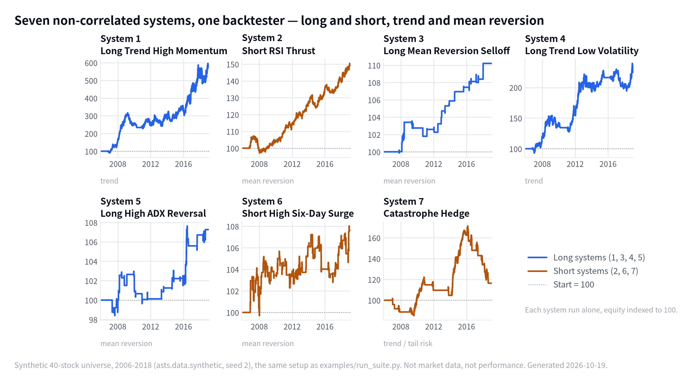
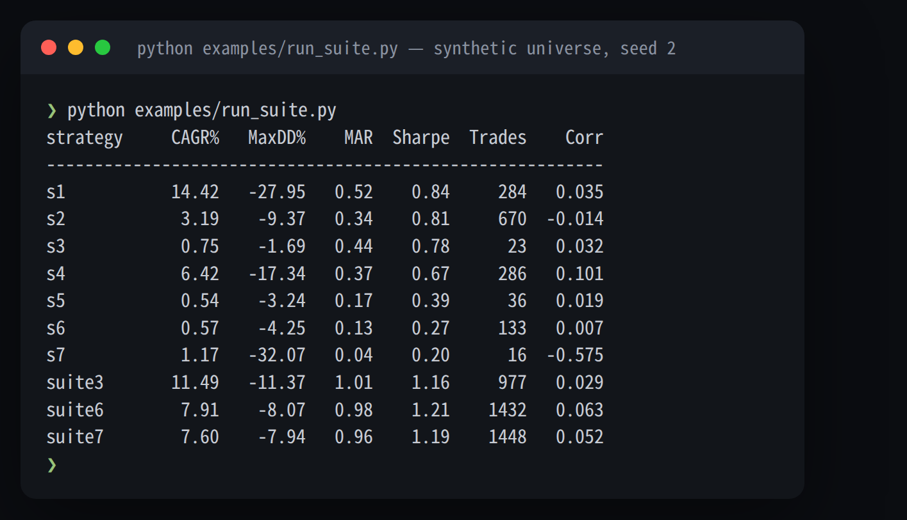
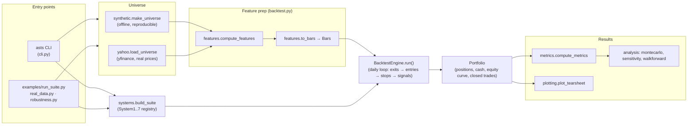

# Automated Stock Trading Systems (ASTS)

**Laurens Bensdorp's seven non-correlated trading systems, re-implemented as one
Python backtester you can run in a minute — no data vendor, no API key.**
An educational re-implementation from the book's published rules, not a
trading product.

[](https://github.com/younghwan91/automated-stock-trading-systems/actions/workflows/ci.yml)
[](https://www.python.org/)
[](LICENSE)
[](https://www.linkedin.com/in/younghwan-chae/)

<picture>
  <source media="(prefers-color-scheme: dark)" srcset="docs/images/hero-dark.png">
  
</picture>

- **Seven systems, deliberately unalike**: four long, three short; three
  trend-following, four mean-reversion; one of them a short-SPY crash hedge.
- **Runs offline**: the default universe is synthetic (`asts.data.synthetic`) —
  random-walk stocks plus an index with scripted bull/bear regimes, so trend
  filters and the catastrophe hedge actually fire. Reproducible by seed.
- **One engine for all seven**: daily event loop, next-day MOO/MOC/limit fills,
  protective and trailing stops, 2% percent-risk sizing, max 10 positions per
  system. A new system is a class that declares entry and exit logic.

> ⚠️ **Not investment advice.** Research and education only. See
> [`DISCLAIMER.md`](DISCLAIMER.md).

## Quick start

```bash
pip install -e .                     # core: pandas, numpy, pyyaml
python examples/run_suite.py         # each system alone vs. the suites; ~10 s offline
asts list                            # systems and suites
asts run --suite suite7 --synthetic  # all 7, offline
pip install -e ".[data]"             # + yfinance, for real prices
asts run --suite suite6 --symbols AAPL,MSFT,JPM --start 2010-01-01 --end 2019-12-31
```

## The seven systems

| System | Name | Style | Side | Edge & Entry Rule | Exit / Protection |
|---|---|---|---|---|---|
| **System 1** | Long Trend High Momentum | Trend | Long | SPY > SMA100, Stock SMA25 > SMA50; enter MOO on top 200d ROC | 25% trailing stop, 5×ATR initial stop |
| **System 2** | Short RSI Thrust | Mean Reversion | Short | 2 up days, RSI(3) > 90; sell short limit +4% above prior close | +4% target (MOC) or 2-day time exit |
| **System 3** | Long Mean Reversion Selloff | Mean Reversion | Long | Stock > SMA150, 3-day drop ≥ 12.5%; buy limit -7% below close | +4% target (MOC) or 3-day time exit |
| **System 4** | Long Trend Low Volatility | Trend | Long | SPY > SMA200, HV(100) ∈ [10%, 40%], rank by lowest RSI(4) | 20% trailing stop, 1.5×ATR stop |
| **System 5** | Long High ADX Reversal | Mean Reversion | Long | Close > SMA100+1×ATR, ADX(7) > 55, RSI(3) < 50; buy limit -3% | +1×ATR target (MOO) or 6-day time exit |
| **System 6** | Short High Six-Day Surge | Mean Reversion | Short | 6-day gain ≥ 20%, 2 up closes; sell short limit +5% | +5% target (MOC) or 3-day time exit |
| **System 7** | Catastrophe Hedge | Trend / Tail Risk | Short (SPY) | SPY close = 50-day low; covers tail-risk crashes (1987/2008) | Cover on 70-day SPY high |

Suites follow the book's chapters: `suite3` (1, 3 + 2), `suite6` (1, 3, 4, 5 +
2, 6), `suite7` (suite6 + the hedge). Full rule definitions:
[`docs/systems_spec.md`](docs/systems_spec.md). `examples/custom_system.py`
adds an eighth system by subclassing `TradingSystem`.

## Why seven systems

A single edge is fragile. The book's argument is that conceptually different
systems — long and short, trend-following and mean-reversion — draw down at
different times, so running them together smooths the equity curve. That is
the claim `examples/run_suite.py` puts side by side:



Read the numbers as evidence that the code implements the rules, not as
performance — the universe is synthetic. The full table, a tear sheet, and the
Monte Carlo / position-sizing sensitivity / walk-forward checks
(`asts montecarlo|sensitivity|walkforward`) are in
[`docs/results.md`](docs/results.md) and [`docs/robustness.md`](docs/robustness.md).

## Architecture

`run_backtest()` (`backtest.py`) is the single high-level entry point:
universe → features/bars → `BacktestEngine` → `Portfolio` → `Metrics`. The CLI
(`asts run|montecarlo|sensitivity|walkforward|list`) and the scripts under
`examples/` are thin callers of the same function.



## Limits

- The default universe is **synthetic**: reproducible, survivorship-bias-free by construction, not the market.
- The `yfinance` loader gives real prices but a survivorship-biased universe:
  delisted names are absent, so those results skew optimistic.
- No live trading, no broker integration, no intraday data.

## Development

```bash
pip install -e ".[dev]" && pytest
```

## Attribution and license

The strategies are Laurens Bensdorp's, described in
*[Automated Stock Trading Systems: A Systematic Approach for Traders to Make
Money in Bull, Bear and Sideways Markets](https://www.tradingmasteryschool.com/)*
(Lioncrest Publishing, 2020). This is an independent re-implementation from the
book's published rule descriptions, for study — no text, code, or data from the
book is reproduced here, and the project is **not** affiliated with or endorsed
by the author or publisher. If the systems interest you, buy the book.

Code is MIT ([`LICENSE`](LICENSE)). Backtested performance does not predict
future results.

## Issues & Contributing

- 🐛 Bugs & questions → [Issues](https://github.com/younghwan91/automated-stock-trading-systems/issues)
- 📈 Updates → [Follow @younghwan91](https://github.com/younghwan91)


## Related projects — open-source quant stack

Part of an open-source stack spanning Korean equities, US equities and crypto. Each repository stands on its own.

| Market | Project | What it is |
|---|---|---|
| 🇰🇷 Korean equities | **[kiwoom-client](https://github.com/younghwan91/kiwoom-client)** | Kiwoom Securities REST API client — full domestic-equity endpoint coverage, real-time WebSocket, sync + async (`pip install kiwoom-client`) |
| 🇰🇷 Korean equities | **[krx-fundamentals-client](https://github.com/younghwan91/krx-fundamentals-client)** | Korean corporate fundamentals Python client library — financial statements, valuation, dividends, screening (DART + KRX + Naver) |
| 🇰🇷 Korean equities | **[krx-news-client](https://github.com/younghwan91/krx-news-client)** | Korean market news & disclosures as one schema — Python client library (DART + Toss Securities) |
| 🇰🇷 Korean equities | **[krx-quant-core](https://github.com/younghwan91/krx-quant-core)** | Shared Python core for Korean-equity quant systems — KRX tick, price-limit and session rules, date-aware transaction-tax cost model, Kiwoom order guards, DART material-disclosure risk classification, fill simulation, Deflated Sharpe and purged CV stats |
| 🇰🇷 Korean equities | **[fin-checkup](https://github.com/younghwan91/fin-checkup)** | Telegram alerts for risk disclosures + a DART/SEC financial health checkup — reports measurements and facts, never a recommendation |
| 🇰🇷 Korean equities | **[quant-airflow](https://github.com/younghwan91/quant-airflow)** | Airflow pipeline collecting Korean market data into TimescaleDB — delisted names included, so downstream backtests aren't survivorship-biased |
| 🇰🇷 Korean equities | **[swing-it](https://github.com/younghwan91/swing-it)** | KOSPI/KOSDAQ alpha validation framework — judged on the per-trade distribution, with random null controls, purged CV and Deflated Sharpe enforced as CI guardrails |
| 🇺🇸 US equities | **[portfolio-research](https://github.com/younghwan91/portfolio-research)** | US equity factor engine — walk-forward gated by Deflated Sharpe and PBO on point-in-time, survivorship-bias-free data; tactical ETF allocation goes through the same gate |
| 🇺🇸 US equities | **[macro-sector-agent](https://github.com/younghwan91/macro-sector-agent)** | Top-down US sector-cycle research — asks which industry has been forgotten, not what to buy; the machine excludes, never picks |
| ₿ Crypto | **[binance-quant-engine](https://github.com/younghwan91/binance-quant-engine)** | Crypto futures backtest & execution engine — zero lookahead, backtest↔live parity |
| ₿ Crypto | **[crypto-quant-insights](https://github.com/younghwan91/crypto-quant-insights)** | Chart-backed research notes from validating a live futures system — crash stress tests, Kelly leverage, live/backtest execution gaps |

## Author

**Younghwan Chae** · [GitHub @younghwan91](https://github.com/younghwan91) · [LinkedIn](https://www.linkedin.com/in/younghwan-chae/)

See the full open-source quant stack on my [profile](https://github.com/younghwan91).
