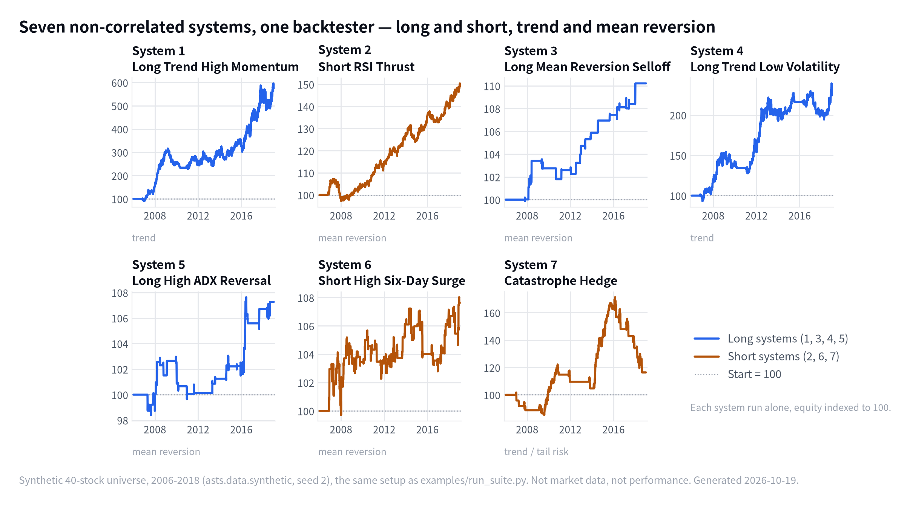
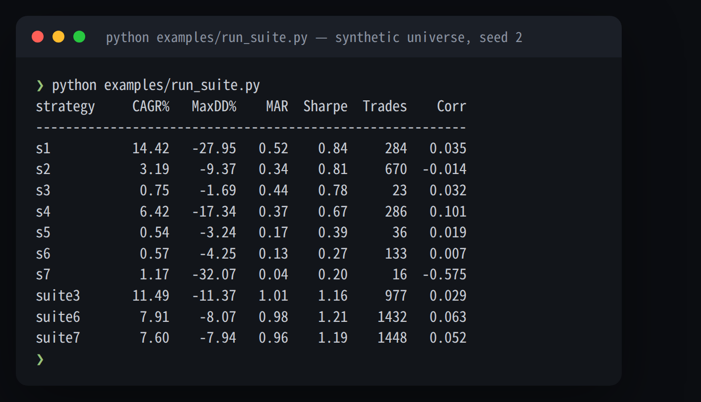

<div align="center">

<picture>
  <source media="(prefers-color-scheme: dark)" srcset="docs/images/brand/wordmark-dark.svg">
  
</picture>

# automated-stock-trading-systems

**Laurens Bensdorp's seven non-correlated trading systems, re-implemented as one Python backtester you can run in a minute — no data vendor, no API key.**

An unofficial study companion to the book *Automated Stock Trading Systems* (Laurens Bensdorp, 2020): the book's published rules as runnable code, so you can watch each system trade. Not affiliated with or endorsed by the author or publisher; not a trading product.

[](https://github.com/younghwan91/automated-stock-trading-systems/actions/workflows/ci.yml)
[](https://www.python.org/)
[](LICENSE)

[Docs](docs/guide.md) · [Systems](docs/systems_spec.md) · [Results](docs/results.md) · [한국어](README.ko.md)

</div>

<picture>
  <source media="(prefers-color-scheme: dark)" srcset="docs/images/hero-dark.png">
  
</picture>

<p align="center"><sub>Seven Bensdorp systems backtested individually on the synthetic universe (equity indexed to 100).</sub></p>

## Try it

One line, real prices, equity curve printed in your terminal (needs internet for the Yahoo download; no API key):

```bash
pip install -e ".[data]" && asts run --suite suite6 --symbols AAPL,MSFT,JPM --start 2010-01-01 --end 2019-12-31 --chart
```

It ends with the performance summary and a text chart of the account equity, for example:

```text
Equity curve
     166,753 |                                                           *
     142,479 |                                                ***  *
     118,205 |                           *****  *******
     100,000 |*************
```

(Excerpt of an actual run; a 3-stock hand-picked universe, so illustrative only.) Prefer fully offline? Use the quick start below.

## Quick start

```bash
pip install -e .
python examples/run_suite.py
asts run --suite suite7 --synthetic
```

This installs the core package (`pandas`, `numpy`, `pyyaml`), compares each system against the combined suites in ~10 seconds offline, and runs all seven systems on the reproducible synthetic universe.

## The seven systems

- **Seven systems, deliberately unalike**: four long, three short; three trend-following, four mean-reversion; one of them a short-SPY crash hedge.
- **Runs offline**: the default universe is synthetic (`asts.data.synthetic`) — random-walk stocks plus an index with scripted bull/bear regimes, so trend filters and the catastrophe hedge actually fire.
- **One engine for all seven**: daily event loop, next-day MOO/MOC/limit fills, protective and trailing stops, 2% percent-risk sizing, max 10 positions per system.

| System | Name | Style | Side | Edge & Entry Rule | Exit / Protection |
|---|---|---|---|---|---|
| **System 1** | Long Trend High Momentum | Trend | Long | SPY > SMA100, Stock SMA25 > SMA50; enter MOO on top 200d ROC | 25% trailing stop, 5×ATR initial stop |
| **System 2** | Short RSI Thrust | Mean Reversion | Short | 2 up days, RSI(3) > 90; sell short limit +4% above prior close | +4% target (MOC) or 2-day time exit |
| **System 3** | Long Mean Reversion Selloff | Mean Reversion | Long | Stock > SMA150, 3-day drop ≥ 12.5%; buy limit -7% below close | +4% target (MOC) or 3-day time exit |
| **System 4** | Long Trend Low Volatility | Trend | Long | SPY > SMA200, HV(100) ∈ [10%, 40%], rank by lowest RSI(4) | 20% trailing stop, 1.5×ATR stop |
| **System 5** | Long High ADX Reversal | Mean Reversion | Long | Close > SMA100+1×ATR, ADX(7) > 55, RSI(3) < 50; buy limit -3% | +1×ATR target (MOO) or 6-day time exit |
| **System 6** | Short High Six-Day Surge | Mean Reversion | Short | 6-day gain ≥ 20%, 2 up closes; sell short limit +5% | +5% target (MOC) or 3-day time exit |
| **System 7** | Catastrophe Hedge | Trend / Tail Risk | Short (SPY) | SPY close = 50-day low; covers tail-risk crashes (1987/2008) | Cover on 70-day SPY high |

Suites follow the book's chapters: `suite3` (1, 3 + 2), `suite6` (1, 3, 4, 5 + 2, 6), `suite7` (suite6 + the hedge). Full rule definitions live in [`docs/systems_spec.md`](docs/systems_spec.md), and `examples/custom_system.py` shows how to add an eighth system by subclassing `TradingSystem`.

## Why seven systems

A single edge is fragile. Conceptually different systems — long and short, trend-following and mean-reversion — draw down at different times, so running them together smooths the equity curve.



Read the numbers as evidence that the code implements the rules, not as performance — the universe is synthetic. The full table, a tear sheet, and the Monte Carlo / position-sizing sensitivity / walk-forward checks (`asts montecarlo|sensitivity|walkforward`) are in [`docs/results.md`](docs/results.md) and [`docs/robustness.md`](docs/robustness.md).

## Use your own data

```bash
asts list                            # list available systems and suites
pip install -e ".[data]"             # + yfinance, for real prices
asts run --suite suite6 --symbols AAPL,MSFT,JPM --start 2010-01-01 --end 2019-12-31
```

## Caveats

- **Not investment advice**: research and education only. See [`DISCLAIMER.md`](DISCLAIMER.md).
- **Synthetic default**: reproducible and survivorship-bias-free by construction, not the market.
- **Survivorship bias on real data**: the `yfinance` loader omits delisted names, so results skew optimistic.
- **Scope**: no live trading, no broker integration, no intraday data.

## Docs

| Doc | What's inside |
|---|---|
| [`docs/guide.md`](docs/guide.md) | Architecture diagram, module flow, and development setup |
| [`docs/systems_spec.md`](docs/systems_spec.md) | Full entry, exit, stop, and sizing rules for all 7 systems |
| [`docs/results.md`](docs/results.md) | Synthetic suite metrics and tear sheet output |
| [`docs/robustness.md`](docs/robustness.md) | Monte Carlo, sizing sensitivity, and walk-forward checks |
| [`DISCLAIMER.md`](DISCLAIMER.md) | Research and educational use disclaimer |

## More from the same author

- [kiwoom-client](https://github.com/younghwan91/kiwoom-client): unofficial Python client for the Kiwoom REST API (182 endpoints, real-time WebSocket, MCP server).
- [fin-checkup](https://github.com/younghwan91/fin-checkup): traffic-light financial check-up for Korean listed companies, with formulas and thresholds shown. Measurements only, no advice.

## Contributing

- **Bugs & questions**: open an issue on [Issues](https://github.com/younghwan91/automated-stock-trading-systems/issues).
- **Development**: see [`docs/guide.md`](docs/guide.md#development) for local test setup (`pytest`).
- **Author**: **Younghwan Chae** · [GitHub @younghwan91](https://github.com/younghwan91) · [LinkedIn](https://www.linkedin.com/in/younghwan-chae/)

## Attribution

The strategies are Laurens Bensdorp's, described in *[Automated Stock Trading Systems: A Systematic Approach for Traders to Make Money in Bull, Bear and Sideways Markets](https://www.tradingmasteryschool.com/)* (Lioncrest Publishing, 2020). This is an independent re-implementation from the book's published rule descriptions for study — no text, code, or data from the book is reproduced here, and the project is **not** affiliated with or endorsed by the author or publisher.

## License

MIT — see [`LICENSE`](LICENSE). Backtested performance does not predict future results.
