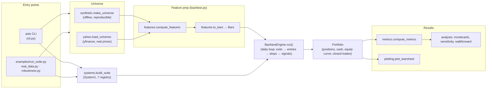

# Project Guide

New here? Start with the [README](../README.md).

<!-- toc -->
- [Architecture](#architecture)
- [Development](#development)
<!-- /toc -->

## Architecture

`run_backtest()` (`backtest.py`) is the single high-level entry point:
universe → features/bars → `BacktestEngine` → `Portfolio` → `Metrics`. The CLI
(`asts run|montecarlo|sensitivity|walkforward|list`) and the scripts under
`examples/` are thin callers of the same function.



## Development

```bash
pip install -e ".[dev]" && pytest
```
